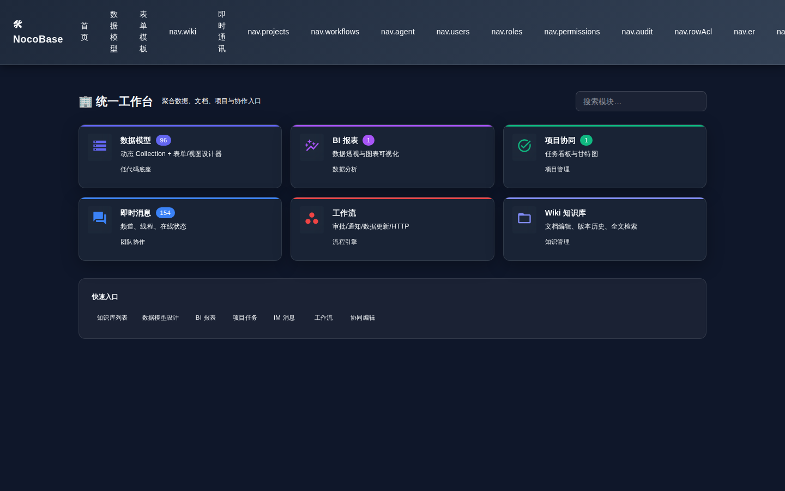
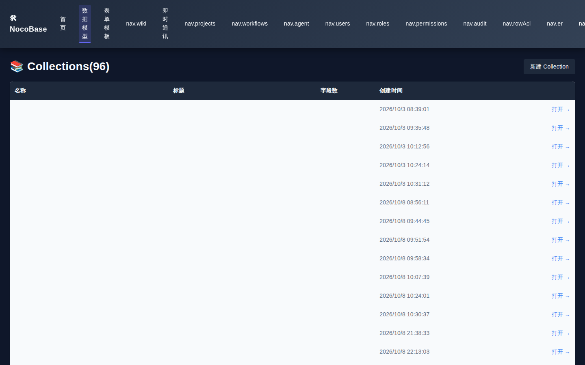
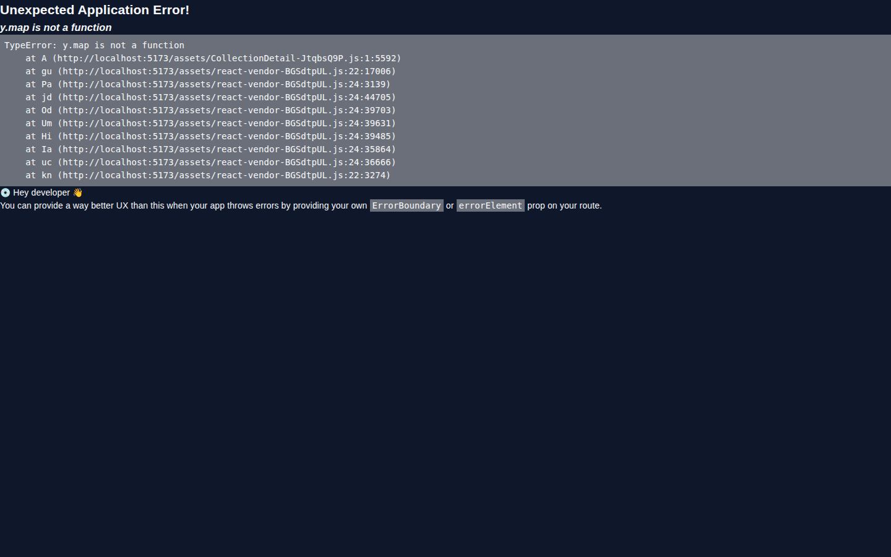
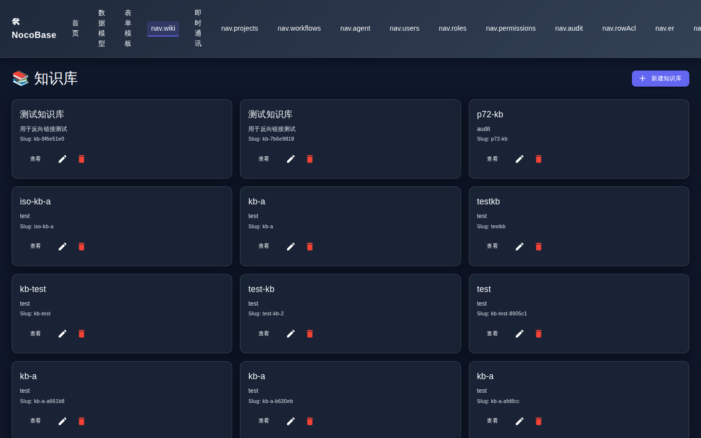
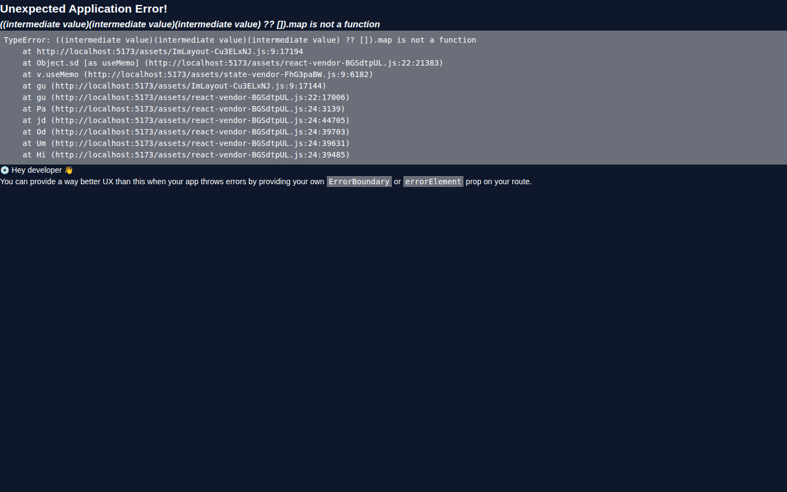
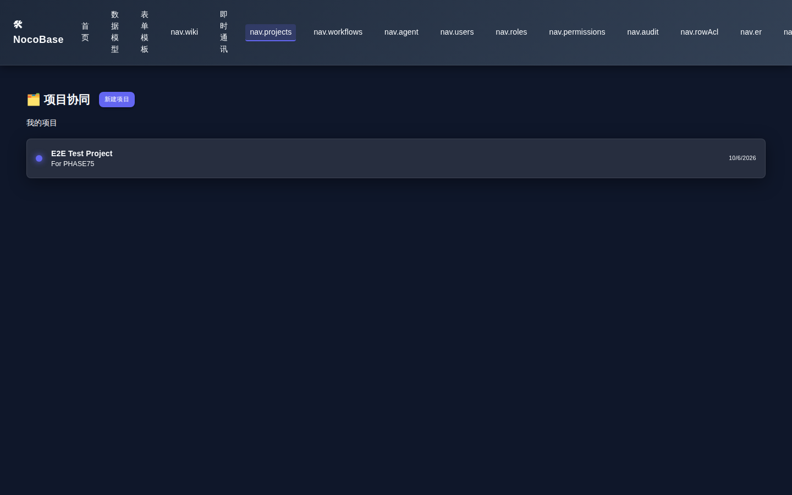

<div align="center">

# DBCool

**自部署的企业协作低代码平台 —— 数据表 · 文档 Wiki · 即时通讯 · 看板 · 工作流 · AI，一套全有**

**v2.1.2**（当前稳定版，发布于 2026-10-30）

[](CHANGELOG.md)
[](LICENSE)
[-brightgreen)](#-质量)
[](#-质量)

**Apache-2.0 开源 · 可私有化部署 · 支持订阅与企业版附加**

</div>

---

## 这是什么

DBCool 是一个 **NocoBase 风格的中文企业协作平台**，把七类工具合为一体，专为「数据不出内网」的企业设计：

> 空气表格（Airtable/NocoDB）+ 文档知识库（Notion）+ 团队 IM（Slack）+ 项目看板（Trello）+ 审批自动化（钉钉 OA）+ AI 助手，**可自部署、可嵌入钉钉/企业微信/飞书/微信**。

**与云 SaaS 的核心区别**：数据全部留在你的 PostgreSQL 里；平台跑在你自己的服务器或 K8s 上。

## 能干什么

| 能力 | 说明 | 对标 |
|---|---|---|
| 🗃️ 数据引擎 | 动态建表、25 种字段类型、公式/汇总/查找、字段级+行级+操作级 ACL、CSV 导入导出、批量操作 | Airtable / NocoDB |
| 📄 文档 Wiki | 块编辑器、版本历史、反向链接、知识库分类、中文分词检索 + pgvector 语义混合检索 | Notion |
| 💬 即时通讯 | 频道/私信/线程/表情回执/已读/置顶/阅后即焚/斜杠命令/@提及/语音 Huddle（WebRTC） | Slack / RocketChat |
| 📋 看板与项目 | 拖拽落库看板、任务清单、标签、截止日、甘特图、双视图模式 | Trello |
| ⚙️ 工作流 | 可视化编排、条件分支、Cron 定时（Redis 分布式锁）、死信队列、审计 | NocoBase / 钉钉 OA |
| 🤖 AI 助手 | Agent 对话、提示词模板、RAG 混合检索（sentence-transformers 768 维） | Notion AI |
| 🔌 平台嵌入 | **钉钉 / 企业微信 / 飞书 / 微信** 四平台 JS-SDK 签名 + OAuth 扫码登录 + 审批回调（验签+防重放） | ——（云 SaaS 做不到） |
| 🏢 企业级 | Schema 级多租户隔离、租户配额、审计日志 39+ 调用点、Prometheus/Loki/Jaeger 全套可观测 | NocoBase |

完整能力矩阵与七强对标实证见 [`docs/PLATFORM_BENCHMARK_ANALYSIS_2026-10-30.md`](docs/PLATFORM_BENCHMARK_ANALYSIS_2026-10-30.md)。

## 30 秒上手

```bash
git clone https://github.com/whoamiWo/dbcool.git && cd dbcool
./install.sh all          # 自动装 Docker/JDK 依赖并启动全栈（Ubuntu/Debian/RHEL 系/麒麟）
```

启动后：

| 服务 | 地址 |
|---|---|
| 前端 | http://localhost |
| Java 后端 | http://localhost:8080/api/health |
| Python 后端 | http://localhost:8000/api/health |

## 界面一览

| 工作台 | 数据表设计 | 集合详情 |
|---|---|---|
|  |  |  |

| 文档知识库 | 即时通讯 | 项目看板 |
|---|---|---|
|  |  |  |

> 截图由 `scripts/screenshot-demo.mjs`（Playwright，登录态）自动生成，随演示数据一并更新。

## 部署方式

| 方式 | 适用 | 入口 |
|---|---|---|
| **Docker Compose**（推荐） | 单机 / 小团队 | `./install.sh all` 或 `docker compose up -d` |
| **离线包**（内网/断网） | 无外网生产环境 | `bash scripts/package-offline.sh` → `packaging/offline/install-offline.sh`（beta，断网安装待实测） |
| **K8s 裸 yaml** | 已有集群 | `kubectl apply -f k8s/` |
| **Helm** | 参数化集群部署 | `helm install dbcool charts/dbcool`（beta，未实测） |
| **升级** | 版本迭代 | `bash scripts/upgrade.sh --from <旧> --to <新>`（自动备份+回滚） |

详见 [`docs/upgrade-runbook.md`](docs/upgrade-runbook.md) 与 [`docs/install-support-matrix.md`](docs/install-support-matrix.md)。

## 质量

全部数字可当场复现（标注「实测于 2026-10-30 @02b3a59」）：

| 门禁 | 结果 |
|---|---|
| Java `mvn -o verify` | ✅ 2614 tests / 0 Failures / 0 Errors；JaCoCo BUNDLE 行覆盖 **80.24%**（红线 0.79） |
| 前端 `npm run test:run` | ✅ 119 files / **972 passed / 0 failed / 0 unhandled errors**；行覆盖 77.12% |
| TypeScript `tsc --noEmit` | ✅ 0 errors |
| 前后端契约 | ✅ 438 后端端点 × 130 前端调用 → **0 漂移**（含反向自检） |
| 备份/PITR 演练 | ✅ 30/30（含真实时间点恢复） |
| 冒烟 / 租户隔离 | ✅ 13/13 · 16/16 |
| 上线终验 | ✅ 8/8 |
| Playwright E2E | 159 用例（上次实测通过；最近批次未复跑，以 CI 为准） |

## 技术栈

**Java 21 · Spring Boot 3.4**（业务后端）｜**Python 3.12 · FastAPI**（AI/集成）｜**React 18 · Vite 5 · TypeScript**（前端）｜**Node · Yjs**（CRDT 协同）｜**PostgreSQL 16 + pgvector** · **Redis** · **RabbitMQ** · **MinIO**

## 文档

| 文档 | 内容 |
|---|---|
| [`docs/PRODUCTIZATION_ROADMAP.md`](docs/PRODUCTIZATION_ROADMAP.md) | 产品化路线图（唯一权威）：展示 / 私有化 / 企业支持 |
| [`docs/WAVE1_PRIVATE_DELIVERY_TASKS.md`](docs/WAVE1_PRIVATE_DELIVERY_TASKS.md) | 私有化交付包任务书（镜像/离线包/Helm/升级） |
| [`docs/PLATFORM_BENCHMARK_ANALYSIS_2026-10-30.md`](docs/PLATFORM_BENCHMARK_ANALYSIS_2026-10-30.md) | 七强对标实证与差距清单 |
| [`docs/backup-restore-runbook.md`](docs/backup-restore-runbook.md) / [`docs/key-rotation-runbook.md`](docs/key-rotation-runbook.md) | 备份恢复 / 密钥轮换 |
| [`docs/enterprise-onboarding.md`](docs/enterprise-onboarding.md) / [`docs/acceptance-checklist.md`](docs/acceptance-checklist.md) | 企业客户入职指南 / 上线验收清单 |
| [`SUPPORT.md`](SUPPORT.md) / [`docs/sla.md`](docs/sla.md) | 支持渠道与分级 / 服务级别协议 |
| [`CONTRIBUTING.md`](CONTRIBUTING.md) / [`TRADEMARK.md`](TRADEMARK.md) | 贡献指南 / 商标与署名政策 |
| [`docs/DEVELOPMENT_NOTES.md`](docs/DEVELOPMENT_NOTES.md) | 开发者手册（模块结构 / 里程碑 / 历史工程记录） |

## 路线图与支持

- 当前方向：**项目展示 + 私有化部署 + 企业支持**（不再新增业务功能），见[路线图](docs/PRODUCTIZATION_ROADMAP.md)。
- **支持**：Apache-2.0 核心开源；企业支持与附加组件按订阅提供 —— 渠道与分级见 [SUPPORT.md](SUPPORT.md)，SLA 见 [docs/sla.md](docs/sla.md)，贡献指南见 [CONTRIBUTING.md](CONTRIBUTING.md)。
- **安全**：漏洞披露流程见 [`SECURITY.md`](SECURITY.md)。

## 许可证

[Apache License 2.0](LICENSE)（含专利授权与反诉终止条款）。商标与署名见 [NOTICE](NOTICE)。
