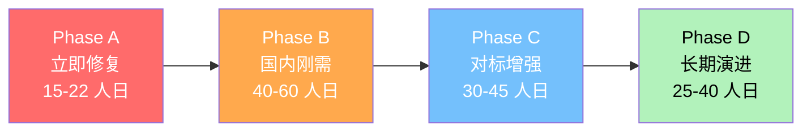

# 四阶段能力补全路线图（Phase A → D）

> 基线：`f752535`（v2.1.0，2026-10-26）
> 依据：`CAPABILITY_MATRIX_DETAIL.md` §13 优先级 + `EMBED_INTEGRATION_ASSESSMENT.md` §5
> 目标：从"核心闭环成熟"演进到"对标主流 + 国内企业刚需全覆盖"

---

## 一、总体演进视图

**能力覆盖度雷达（当前 vs 目标）**

| 能力域 | 当前 | Phase A 后 | Phase B 后 | Phase D 后 |
|---|---|---|---|---|
| 数据模型 | 85% | 85% | 95% | 98% |
| 表单 | 90% | 90% | 95% | 98% |
| 视图 | 70% | 85% | 92% | 98% |
| 权限 | 75% | 95% | 95% | 98% |
| 工作流 | 90% | 90% | 95% | 98% |
| IM | 85% | 85% | 90% | 95% |
| Wiki | 95% | 95% | 97% | 98% |
| 协同 CRDT | 60% | 95% | 95% | 98% |
| 平台嵌入 | 55% | 70% | 92% | 95% |
| 外部数据源 | 0% | 0% | 80% | 95% |
| AI | 65% | 65% | 80% | 92% |
| 多租户/计费 | 50% | 50% | 85% | 95% |

---

## 二、Phase A — 立即修复（🔴 P0，15–22 人日）

> **目标**：解除企业级上线阻塞。修完即达"内部 200–500 人上线"标准。

| # | 任务 | 域 | 工作量 | 验收标准 |
|---|---|---|---|---|
| A1 | ~~补齐 k8s `CRDT_SERVICE_URL` 配置~~ **✅ 已完成** | 协同 | 0.5 人日 | `k8s/02-backend-java.yaml:61-62` 已注入 `CRDT_SERVICE_URL: http://crdt-service:80`（2026-10-28 回写）。⚠️ 配套遗留：`k8s/11-crdt-service.yaml` 引用了不存在的 Secret `nocobase-secrets`（实际为 `nocobase-secret`），见 Wave5 阶段 2 |
| A3 | 看板拖拽移动 | 视图 | 4–6 人日 | `KanbanView` 支持卡片跨列拖拽并落库；E2E 验证 |
| A4 | 统一 `JsSignatureProvider`（钉钉+企微+飞书） | 嵌入 | 5–8 人日 | 前端 `dd.config`/`wx.agentConfig`/`h5Webview` 注入成功；ticket 走 Redis 缓存 |

> ⚠️ **已移除 A2（字段级权限）**：经实证复核，该能力**已实现且已接线**
> （`AclPolicyEntity.Type=FIELD` + `AclEnforcer.filterReadableFields/filterRecord/filterWritableFields`
> + `CollectionController` 4 处调用 + `AclEditor` 前端配置）。
> 上一版因检索关键词不当（`fieldLevel|FieldPermission`）误判为缺失。详见
> [`CAPABILITY_MATRIX_DETAIL.md`](./CAPABILITY_MATRIX_DETAIL.md) §5 订正说明。

**依赖关系**：无强依赖，可并行。A1 建议最先做（0.5 人日，风险最低收益最高）。
A4 建议优先于 A3（解锁"嵌入工作台"核心诉求）。

---

## 三、Phase B — 国内企业刚需（🟡 P1，40–60 人日）

> **目标**：覆盖中国企业场景刚需（微信生态、外部系统对接、商业化）。

| # | 任务 | 域 | 工作量 | 验收标准 |
|---|---|---|---|---|
| B1 | 微信 JS-SDK 嵌入（签名+注入+分享/拍照） | 嵌入 | 5–8 人日 | 微信内可打开页面；可调 `chooseImage`/`onMenuShare` |
| B2 | 微信 OAuth（公众号+小程序 `code2Session`） | 嵌入 | 5–8 人日 | 微信扫码可登录；openid 映射 `ExternalUserMapping` |
| B3 | 外部数据源集成（MySQL/PG） | 集成 | 15–20 人日 | 可连接外部库、读取表结构、创建虚拟表、全量/增量同步 |
| B4 | 计费与套餐（套餐/周期/支付/发票） | 商业化 | 10–15 人日 | `PlanTier`/`BillingCycle` 模型；Stripe+支付宝接入；账单页可用 |
| B5 | 甘特图视图 | 视图 | 5–8 人日 | 支持 start/end/progress 字段；依赖线渲染 |
| B6 | 订阅消息 Dispatcher（微信/钉钉） | 嵌入 | 3–5 人日 | 可下发订阅/模板消息 |

**依赖**：B1 依赖 A4（签名服务抽象）；B2 依赖 B1；B4 依赖多租户配额（已有）。

---

## 四、Phase C — 对标增强（🟢 P2，30–45 人日）

> **目标**：拉近与 Airtable/Notion/Slack 的体验差距。

| # | 任务 | 域 | 工作量 |
|---|---|---|---|
| C1 | 公式函数库扩充（数组函数 `ARRAY_JOIN`/`UNIQUE`/`FILTER`） | 数据 | 5–8 人日 |
| C2 | 冻结列 + 条件格式 | 视图 | 4–6 人日 |
| C3 | 日历周/年视图 + 事件拖拽改期 | 视图 | 5–8 人日 |
| C4 | AI `PromptTemplateRepository` + 多模型支持 | AI | 5–8 人日 |
| C5 | 字段类型扩充（rating/duration/user/button/createdTime） | 数据 | 6–10 人日 |
| C6 | IM @全体提及 + 消息引用/转发 | IM | 3–5 人日 |
| C7 | 飞书独立卡片消息 Dispatcher | 嵌入 | 2–3 人日 |
| C8 | 批量编辑前端入口 | 数据 | 3–5 人日 |

---

## 五、Phase D — 长期演进（⚪ P3，25–40 人日）

> **目标**：愿景级能力，视商业化节奏启动。

| # | 任务 | 域 | 工作量 |
|---|---|---|---|
| D1 | 移动端原生 App（React Native / Flutter） | 移动 | 15–25 人日 |
| D2 | 块级权限控制（Wiki） | 权限 | 5–8 人日 |
| D3 | 子工作流 / 延时节点 | 工作流 | 5–8 人日 |
| D4 | Wiki 分享访问统计 | Wiki | 2–3 人日 |
| D5 | 钉钉官方 `app.message.send` | 嵌入 | 2–3 人日 |

---

## 六、里程碑与验收

| 里程碑 | 内容 | 完成标志 | 累计工作量 |
|---|---|---|---|
| **M-A** | P0 清零（3 项） | K8s 协同正常、看板可拖拽、JS-SDK 注入成功 | 9.5–14.5 人日 |
| **M-B** | 国内刚需覆盖 | 微信可嵌入+登录、外部数据源可用、计费上线、甘特图上线 | 49.5–74.5 人日 |
| **M-C** | 对标追平 | 公式/视图/AI/字段类型全面增强 | 79.5–119.5 人日 |
| **M-D** | 愿景达成 | 移动端 App + 块级权限 + 子工作流 | 104.5–159.5 人日 |

> 说明：M-A 工作量因移除 A2（字段级权限已实现）由 15–22 降至 9.5–14.5 人日，后续里程碑累计值同步下调。

---

## 七、实施原则

1. **实证优先**：所有"已完成"判定须附代码位置或实测证据，禁止推断。
2. **复用现有设施**：评论/通知/外部映射优先复用 `Collection` 引擎、`ExternalUserMapping`、`integration/credential/`，不新建平行服务。
3. **配置三处核查**：凡新增 `@Value` 注入（如 CRDT URL），必须同时核查 `application.yml`、`docker-compose.yml`、`k8s/*.yaml`。
4. **小步快跑**：Phase A 四项无强依赖，可并行推进；优先做 A1（0.5 人日，解除静默降级风险）。
5. **许可合规**：保持与 NocoBase 代码独立（Apache-2.0 + 补充条款禁止 SaaS 化），不 fork。
